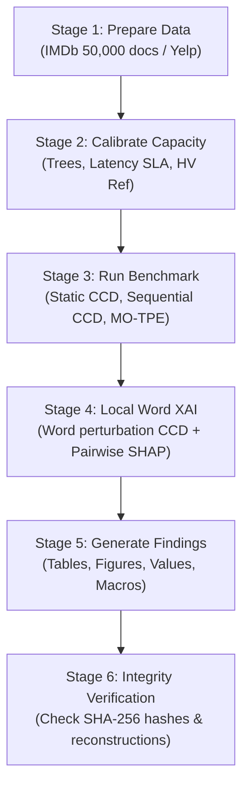

# Scientific Explanation of the Research Experiment

## 1. Executive Summary & Research Vision

This experiment investigates whether classical **Design of Experiments (DOE)** and **Response Surface Methodology (RSM)** can be combined with modern **Explainable Artificial Intelligence (XAI)** to optimize and explain hyperparameters in tree-based gradient boosted models (**XGBoost**) more effectively, predictably, and interpretably than black-box heuristic search (such as Multi-Objective Tree-structured Parzen Estimators, **MO-TPE**).

The research directly unites and operationalizes three foundation documents:
1. **`Original specs.txt`**: Systematic factorial screening and RSM for Machine Learning Hyperparameter Optimization (HPO), fitting classical response surfaces alongside ML models and comparing them with SHAP.
2. **`Remarks,.txt`**: Resolving historical experimental limitations—underfitting via capacity calibration; timing inconsistency via a strict warmed latency protocol (100 warmup inferences + 500 timed single-document calls on pinned CPU core); boundary candidate optimism bias via strictly protected test sets and reserved confirmation coordinates; ANOVA vs SHAP interaction pipeline; sentiment analysis on IMDb; and a clean modular codebase that automatically produces tables, values, and figures.
3. **`Research approach.txt`**: Explainable Sequential DOE combining Face-Centered Central Composite Design (CCD), 2nd-order ANOVA, exact surrogate SHAP attributions, adaptive coordinate augmentation, and independent confirmation on interior and boundary coordinates under equal fit budgets.

---

## 2. Theoretical Foundations & Mathematical Formulations

### 2.1 The 4 Experimental Hyperparameters (Factors)
The study optimizes 4 core XGBoost hyperparameters that control model capacity, variance, and inference complexity:
- **Factor 1 ($x_1$) — Learning Rate ($\eta$)**: Coded range $[-1, +1] \to [0.05, 0.30]$, center $= 0.175$. Linear coding.
- **Factor 2 ($x_2$) — Maximum Tree Depth**: Coded range $[-1, +1] \to [3, 9]$, center $= 6$. Integer coding.
- **Factor 3 ($x_3$) — Row Subsampling Ratio**: Coded range $[-1, +1] \to [0.50, 1.00]$, center $= 0.75$. Linear coding.
- **Factor 4 ($x_4$) — Leaf Regularization ($\lambda$, `reg_lambda`)**: Coded range $[-1, +1] \to [0.10, 10.00]$, center $= 1.00$. Logarithmic coding ($\log_{10}$).

### 2.2 Face-Centered Central Composite Design (CCD)
For $k = 4$ factors, a Face-Centered Central Composite Design ($\alpha = 1.0$) consists of:
- **Factorial Points ($2^k = 16$)**: Vertices of the 4D hypercube $(\pm 1, \pm 1, \pm 1, \pm 1)$.
- **Axial / Star Points ($2k = 8$)**: Centers of the 8 bounding hyperplanes $(\pm 1, 0, 0, 0), \dots, (0, 0, 0, \pm 1)$.
- **Center Points**: The domain center $(0, 0, 0, 0)$, replicated across blocks to estimate pure experimental error.

### 2.3 The 2nd-Order Response Surface Model (RSM)
A full quadratic response surface is fitted via Ordinary Least Squares (OLS) with block effects:
$$
y = \beta_0 + \sum_{i=1}^{k} \beta_i x_i + \sum_{i=1}^{k} \beta_{ii} x_i^2 + \sum_{1 \le i < j \le k} \beta_{ij} x_i x_j + \sum_{b=2}^{B} \gamma_b \text{Block}_b + \varepsilon
$$
Where:
- $\beta_0$: Grand mean intercept.
- $\beta_i$: Linear main effects (first derivatives at center).
- $\beta_{ii}$: Quadratic curvature terms (second derivatives).
- $\beta_{ij}$: Two-factor interaction terms (bilinear cross-derivatives).
- $\gamma_b$: Fixed block nuisance shifts across the 5 cross-validation folds ($B=5$).
- $\varepsilon \sim \mathcal{N}(0, \sigma^2)$: Random residual error.

### 2.4 Analysis of Variance (ANOVA) Decomposition
The total sum of squares is partitioned into:
$$
SS_{\text{Total}} = SS_{\text{Main}} + SS_{\text{Curvature}} + SS_{\text{Interaction}} + SS_{\text{Blocks}} + SS_{\text{Residual}}
$$
Furthermore, residual sum of squares is partitioned into Lack-of-Fit ($SS_{\text{LOF}}$) and Pure Experimental Error ($SS_{\text{PE}}$) from center-point replicates:
$$
F_{\text{LOF}} = \frac{MS_{\text{LOF}}}{MS_{\text{PE}}} = \frac{SS_{\text{LOF}} / df_{\text{LOF}}}{SS_{\text{PE}} / df_{\text{PE}}}
$$
A statistically significant $p_{\text{LOF}} < 0.05$ diagnoses model inadequacy, which triggered the calibration phase in our pipeline.

### 2.5 Explainable AI: Exact Surrogate SHAP
To compare classical ANOVA with modern XAI, Shapley values and pairwise interaction values are computed directly on the fitted surrogate models ($f(\mathbf{x})$):
$$
\phi_i(x) = \sum_{S \subseteq F \setminus \{i\}} \frac{|S|!(|F| - |S| - 1)!}{|F|!} \left[ f(S \cup \{i\}) - f(S) \right]
$$
Because $k=4$, exact Shapley values are calculated by evaluating all $2^4 = 16$ subset coalitions against a frozen empirical background, avoiding Monte Carlo approximation error. Pairwise interaction values $\Phi_{ij}$ capture the synergistic contribution of pairs $(x_i, x_j)$.

---

## 3. The Five Core Research Questions

### Q1 — Explanation Agreement: ANOVA vs SHAP
- **Question**: Do ANOVA 2nd-order interaction terms and surrogate SHAP interaction values agree on which hyperparameters dominate performance, and where do they diverge?
- **Hypothesis**: ANOVA and SHAP agree strongly on top linear factors (e.g. learning rate and tree depth), but diverge on non-linear terms because SHAP attributions integrate across the entire domain, whereas ANOVA partitions variance orthogonal to the center.

### Q2 — Generalization & Boundary Prediction Reliability
- **Question**: Can quadratic response surfaces and non-parametric Gaussian Processes reliably forecast validation loss and latency at untested hyperparameter coordinates, particularly on the domain boundaries?
- **Hypothesis**: Polynomial models exhibit substantial optimism bias and interval under-coverage on boundary coordinates ($x_i = \pm 1$), whereas Gaussian Processes retain calibrated uncertainty intervals.

### Q3 — Sequential Adaptation Efficiency
- **Question**: Does adaptive augmentation (spending center-point replicates on infill coordinates chosen via uncertainty and space-filling) improve surrogate prediction fidelity and Pareto front coverage compared to static CCD?
- **Hypothesis**: Sequential CCD matches or improves hypervolume coverage while enhancing surrogate prediction accuracy in promising regions without increasing the total evaluation budget.

### Q4 — Multi-Objective Benchmark Trade-Off: DOE vs TPE
- **Question**: With an identical evaluation budget ($N=140$ fits per repeat), does Explainable DOE achieve comparable or superior multi-objective Pareto frontiers (Macro F1 Loss vs Latency) compared to Multi-Objective TPE?
- **Hypothesis**: DOE systematically explores the entire design space, achieving higher diversity and predictable feasibility rates, whereas TPE clusters evaluations in local minima.

### Q5 — Local Word-Level Explanations
- **Question**: Can local response surfaces serve as interpretable surrogates for document-level word feature interactions, mirroring LIME but with explicit 2nd-order interaction and curvature terms?
- **Hypothesis**: Local CCD perturbations of the top 4 TF-IDF unigram weights fit a local quadratic surface that explains document predictions with high fidelity ($R^2 > 0.90$) and uncovers significant word-word interactions.

---

## 4. Addressing Supervisor Remarks & Methodological Rigor

| Supervisor Remark / Proposal | Historical Vulnerability | How Our Codebase Resolves It |
|---|---|---|
| **Remark 1: Underfitting & Lack-of-Fit** | 32% of runs suffered underfitting; severe lack-of-fit | Pre-experiment development calibration grid ([100, 300, 600] trees, $\eta \in [0.05, 0.30]$) selects tree count ensuring low-rate F1 is within 0.005 of high-capacity models. |
| **Remark 2: Latency Inconsistency** | 30 unwarmed calls in search vs 500-1000 warmed calls in verification caused false feasibility | Unified protocol: 100 warmup calls + 500 timed single-document calls, pinned CPU affinity on core 0, measuring median latency across all stages. |
| **Remark 3: Holdout Exposure & Boundary Bias** | Holdout exposed; boundary candidate ($d=7$) showed +0.0217 optimism bias | Test partition strictly protected behind a one-time final evaluation gate; 12 reserved confirmation points specifically stratify interior vs boundary coordinates. |
| **Proposal 1: ANOVA vs SHAP Pipeline** | No formal link between statistical design and XAI | Complete automated pipeline computing ANOVA partial SS, exact coalition SHAP, interaction matrices, and Spearman/Kendall ranking correlations. |
| **Proposal 2: Sentiment Task (IMDb)** | California Housing regression was not representative of NLP | Migrated to IMDb sentiment classification (TF-IDF 10,000 unigrams/bigrams, binary classification loss $1 - \text{Macro F1}$). |
| **Proposal 3: Modular Codebase** | Fragmented loose scripts | Unified, modular Python package (`xgb_doe_xai`) and single-entry CLI (`experiment_code/run_experiment.py`) automatically producing tables, values, and plots. |

---

## 5. Experimental Execution Stages



---

## 6. Replication Commands

All operations can be executed with a single command from the project root:

```powershell
# 1. Quick 25-Second Smoke Verification (Synthetic corpus)
python experiment_code/run_experiment.py --stage smoke

# 2. Data Preparation (Downloads and partitions full IMDb)
python experiment_code/run_experiment.py --stage prepare --data-dir data

# 3. Development-Only Calibration (Selects tree count and latency threshold)
python experiment_code/run_experiment.py --stage calibrate --data-dir data --output-dir results/calibration

# 4. Full Experiment Execution (Equal-budget benchmark on full IMDb)
python experiment_code/run_experiment.py --stage run --dataset full_imdb --data-dir data --calibration-dir results/calibration --output-dir results/experiment_run

# 5. Automated Production of All Tables, Figures, and Values
python experiment_code/run_experiment.py --stage generate-findings --output-dir results/experiment_run --findings-dir findings

# 6. Full One-Click Pipeline (Prepare -> Calibrate -> Run -> Words -> Findings)
python experiment_code/run_experiment.py --stage all --dataset full_imdb --data-dir data --findings-dir findings
```
