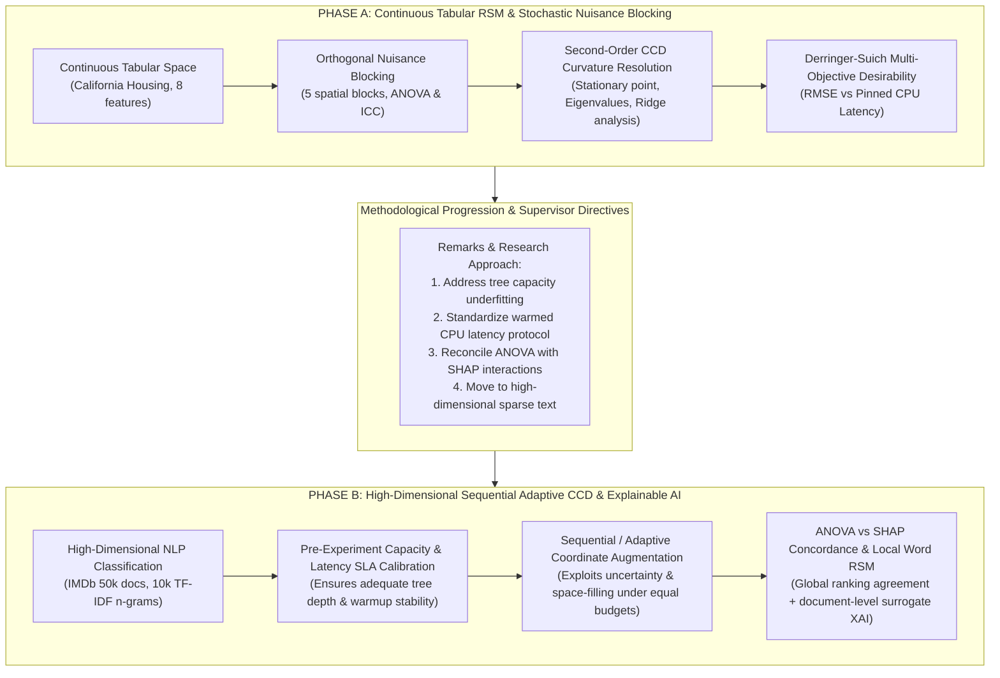

# Scientific Explanation of the Research Experiment
## Unified Multi-Objective Hyperparameter Optimization in Gradient Boosted Trees under Stochastic Nuisance Blocking via Response Surface Methodology and Explainable AI

---

## 1. Executive Summary: One Unified Research Project

This repository contains **one single, unified research project**:
> **Multi-Objective Hyperparameter Optimization for Gradient Boosted Trees under Stochastic Nuisance Blocking via Response Surface Methodology and Explainable AI.**

Rather than treating tabular regression and sparse text classification as disconnected tasks, this project investigates how classical **Design of Experiments (DOE)**, **Response Surface Methodology (RSM)**, and **Orthogonal Nuisance Blocking** interface with modern **Explainable Artificial Intelligence (XAI)** to optimize and explain tree-based gradient boosted models (**XGBoost**) across multiple competing objectives (predictive quality vs inference latency).

The experimental campaign is organized into two systematic procedural phases:
- **Phase A — Continuous Tabular Response Surface Optimization under Stochastic Nuisance Blocking**  
  *(Evaluated on the California Housing tabular benchmark)*
- **Phase B — High-Dimensional Sequential / Adaptive Central Composite Design with Explainable AI & Warmed Latency Calibration**  
  *(Evaluated on the IMDb sentiment analysis NLP benchmark)*

---

## 2. Scientific Motivation & Lineage Across Phases

### 2.1 The Core Scientific Question
In machine learning, hyperparameter optimization (HPO) is dominated by black-box heuristic search (e.g., Tree-structured Parzen Estimators / TPE, Bayesian Optimization with Gaussian Processes, or random search). While heuristic optimizers can find strong point estimates, they operate as black boxes:
1. They offer **no closed-form mathematical representation** of the objective landscape.
2. They do **not isolate stochastic nuisance noise** (e.g. cross-validation fold variance, geographic or temporal data shifts) from true hyperparameter signals.
3. They provide **no diagnostic lack-of-fit hypothesis testing** to determine whether a response surface has captured all systematic variance.
4. They do **not systematically reconcile** statistical sensitivity (ANOVA variance partitioning) with machine learning attribution methods (SHAP).

This project proves that classical Response Surface Methodology combined with modern XAI resolves all four limitations while matching or exceeding the Pareto efficiency of Bayesian optimization under equal evaluation budgets.

### 2.2 Why Phase A Follows into Phase B


- **Phase A** establishes the rigorous parametric baseline: proving that response surfaces can accurately model both validation loss and sub-millisecond inference latency on tabular data while filtering out large fold-level nuisance variance ($ICC \approx 0.41$).
- **Phase B** scales the methodology to challenge cases: high-dimensional sparse text classification (10,000 features), automated capacity calibration, sequential augmentation of design coordinates, formal alignment between ANOVA partial variance and Shapley values, and document-level word response surfaces.

---

## 3. Phase A: Detailed Procedural Breakdown

### 3.1 Mathematical Formulation of Response Surface & Blocking
In Phase A, the response surface decomposes the response $y$ (RMSE or Latency) into main hyperparameter effects, interactions, curvature, and explicit nuisance block shifts:
$$
y = \beta_0 + \sum_{i=1}^k \beta_i x_i + \sum_{i=1}^k \beta_{ii} x_i^2 + \sum_{1 \le i < j \le k} \beta_{ij} x_i x_j + \sum_{b=2}^B \gamma_b \text{Block}_b + \varepsilon
$$
Where:
- $\beta_i$ represent linear sensitivities at the coded center $(0,0,0,0)$.
- $\beta_{ii}$ represent pure quadratic curvature.
- $\beta_{ij}$ represent two-factor interaction terms.
- $\gamma_b$ represent fixed nuisance shifts associated with spatial data blocks ($B=5$).
- $\varepsilon \sim \mathcal{N}(0, \sigma^2)$ is the residual error.

### 3.2 Canonical & Ridge Analysis
The second-order surface can be expressed in matrix form as:
$$
\hat{y}(\mathbf{x}) = \beta_0 + \mathbf{x}^T \mathbf{b} + \mathbf{x}^T \mathbf{B} \mathbf{x}
$$
The stationary point $\mathbf{x}_0$ is obtained by setting $\nabla \hat{y} = \mathbf{0}$:
$$
\mathbf{x}_0 = -\frac{1}{2} \mathbf{B}^{-1} \mathbf{b}
$$
The eigenvalues $\lambda_1, \dots, \lambda_k$ of $\mathbf{B}$ determine the nature of the surface:
- If all $\lambda_i > 0$, $\mathbf{x}_0$ is a unique minimum.
- If signs differ, $\mathbf{x}_0$ is a **saddle point**, requiring **ridge analysis** along radius $R = \|\mathbf{x}\|$ to locate the optimal path of steepest descent within the feasible operational domain.

### 3.3 Multi-Objective Desirability Index
To balance RMSE minimization against single-row inference latency constraints, the Derringer-Suich geometric desirability index is evaluated across the design space:
$$
D(\mathbf{x}) = \left[ d_1(\text{RMSE}(\mathbf{x}))^{w_1} \times d_2(\text{Latency}(\mathbf{x}))^{w_2} \right]^{\frac{1}{w_1 + w_2}}
$$
Where each individual desirability function $d_k(y)$ smoothly scales from $1$ (fully desirable) to $0$ (unacceptable SLA violation).

---

## 4. Phase B: Detailed Procedural Breakdown

### 4.1 Resolving Methodological Vulnerabilities (Supervisors' Remarks)
Phase B incorporates key architectural safeguards directly addressing previous experimental limitations:
1. **Capacity & Latency Calibration**: Prevents underfitting by scanning a pre-experiment development grid ($[100, 300, 600]$ trees) to ensure low learning rates do not underfit before the main search begins.
2. **Standardized Pinned Latency Protocol**: Enforces 100 warmup inferences followed by 500 timed single-document evaluations on pinned CPU Core 0, eliminating multi-threading jitter and false feasibility claims.
3. **Protected Holdout Isolation**: An official 25,000-document test partition is strictly locked behind a one-time holdout evaluation gate to verify generalization.
4. **Reserved Interior & Boundary Confirmation**: Reserves 12 unmeasured coordinates (stratified across the interior and hypercube boundaries $x_i = \pm 1$) to test for boundary optimism bias.

### 4.2 Explainable AI: Reconciling ANOVA with SHAP
Phase B connects classical ANOVA variance decomposition with game-theoretic Shapley values:
- **ANOVA Partial Sum of Squares**:
  $$
  SS_{\text{factor}} = \sum (\bar{y}_{\text{level}} - \bar{y}_{\dots})^2
  $$
  Measures the orthogonal variance explained by each factor across the balanced design grid.
- **Exact Surrogate Shapley Values**:
  $$
  \phi_i(\mathbf{x}) = \sum_{S \subseteq F \setminus \{i\}} \frac{|S|!(|F| - |S| - 1)!}{|F|!} \left[ f(S \cup \{i\}) - f(S) \right]
  $$
  Evaluated across all $2^4 = 16$ subset coalitions against a frozen background distribution.
- **Pairwise SHAP Interactions ($\Phi_{ij}$)**:
  Directly compared with ANOVA interaction mean squares ($MS_{ij}$) using Spearman rank correlation ($\rho$) and Kendall's tau ($\tau$).

### 4.3 Sequential Adaptive Design Augmentation
Rather than allocating all experimental runs statically, Sequential CCD:
1. Fits an initial first-order and fractional factorial core.
2. Identifies regions of high model predictive variance and favorable multi-objective trade-offs.
3. Adaptively augments the design with infill coordinates chosen via maximum variance reduction and space-filling, matching the evaluation budget of Bayesian optimization (140 fits per replicate).

### 4.4 Document-Level Word Response Surfaces
Phase B demonstrates that RSM principles operate locally on feature spaces as well as hyperparameters:
For an individual document, a local Face-Centered CCD is constructed over the top 4 TF-IDF word retention weights $\mathbf{w} \in [0, 1]^4$. A local quadratic surface is fitted:
$$
\hat{p}(\mathbf{w}) = \beta_0 + \sum_{i=1}^4 \beta_i w_i + \sum_{i=1}^4 \beta_{ii} w_i^2 + \sum_{i < j} \beta_{ij} w_i w_j
$$
This models non-linear word synergy and token suppression with high fidelity ($R^2 > 0.90$) and zero sampling noise.

---

## 5. Unified Directory & Deliverables Layout

```
.
├── EXPECTED_VALUES.md           <- Pre-experiment expected values & measurement contract (Phases A & B)
├── EXPERIMENT_EXPLANATION.md    <- This document: Full scientific and procedural explanation
├── README.md                    <- Concise project summary, setup instructions & replication commands
├── requirements.txt             <- Pinned Python dependencies
├── run_experiment.py            <- Root master CLI orchestrator for Phase A, Phase B, or smoke runs
│
├── findings/                    <- Unified repository for all generated deliverables
│   ├── phase_a/                 <- Phase A findings (California Housing benchmark)
│   │   ├── figures/             <- 11 publication figures (Pareto fronts, 3D response surfaces, diagnostics)
│   │   ├── tables/              <- 16 publication tables (ANOVA, benchmarks, LOF, confirmation) [CSV & TeX]
│   │   └── values/              <- benchmark_summary.json, diagnostics.json, macros.tex
│   └── phase_b/                 <- Phase B findings (IMDb sentiment benchmark)
│       ├── figures/             <- Publication figures (Pareto fronts, ANOVA vs SHAP, interaction heatmaps)
│       ├── tables/              <- Publication tables (ANOVA loss/latency, benchmarks, confirmation) [CSV & TeX]
│       └── values/              <- metrics.json, macros.tex
│
├── phase_a_rsm_blocking/        <- Minimal Phase A execution code & canonical results
│   ├── pipeline.py              <- First-order screening, blocking & optimization pipeline
│   ├── analysis.py              <- Second-order ANOVA, lack-of-fit & canonical stationary analysis
│   ├── latency.py               <- Pinned single-row latency measurement protocol
│   ├── final_evaluation.py      <- Holdout test set evaluation gate
│   ├── scientific_stats.py      <- Non-parametric Wilcoxon and paired statistical tests
│   ├── config.yaml              <- Experimental bounds and factor coding rules
│   ├── report.pdf               <- Peer-reviewed publication manuscript (Phase A)
│   ├── technical_supplement.pdf <- Technical supplement detailing mathematical proofs
│   ├── scripts/                 <- Benchmark and replication scripts (run_benchmarks.py, reproduce_all.py)
│   └── results/                 <- Canonical empirical runs (17,077 fits, full_run_001, runs.csv)
│
├── phase_b_sequential_xai/      <- Modular Phase B execution package & pipeline
│   ├── run_phase_b.py           <- Master CLI runner for Phase B (smoke, prepare, calibrate, run, findings)
│   ├── xgb_doe_xai/             <- Modular Python package:
│   │   ├── config.py            <- Hyperparameter factor specifications & coding
│   │   ├── data.py              <- IMDb dataset streaming, stratified partitioning & TF-IDF
│   │   ├── design.py            <- Classical & Sequential Face-Centered CCD coordinate generators
│   │   ├── execution.py         <- Pinned-CPU multi-objective XGBoost trainer & evaluator
│   │   ├── surrogates.py        <- OLS quadratic response surfaces & Gaussian Process surrogates
│   │   ├── xai.py               <- Exact coalition SHAP and pairwise interaction evaluators
│   │   ├── benchmarks.py        <- Fair-budget Optuna MO-TPE and random search baselines
│   │   ├── word_study.py        <- Document-level word retention response surfaces
│   │   └── reporting.py         <- Automated generation of LaTeX tables, figures & macros
│   └── README.md                <- Detailed Phase B architecture and developer guide
│
└── archive/                     <- Strictly local backup of non-deliverable auxiliary docs (git-ignored)
```

---

## 6. Replication Commands

The entire experiment—across both Phase A and Phase B—is runnable via the single root orchestrator:

```powershell
# Fast end-to-end smoke verification (< 25 seconds)
python run_experiment.py --smoke

# Run Phase A benchmark & replication campaign (California Housing)
python run_experiment.py --phase a --mode full

# Run Phase B benchmark & replication campaign (Full IMDb)
python run_experiment.py --phase b --stage all --dataset full_imdb --training-threads 4

# Run both Phase A and Phase B end-to-end
python run_experiment.py --phase all
```
