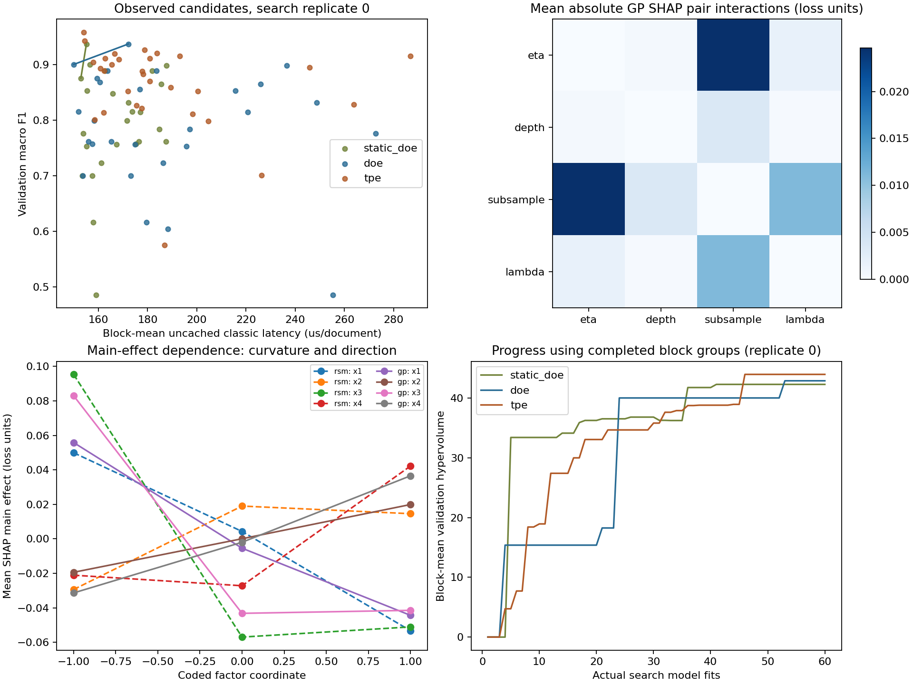

# Explainable sequential DOE study

Evidence classification: **smoke**.
Synthetic/smoke results validate execution only; they support no real-data scientific conclusion.

| Method | Search fits | Mean validation hypervolume | SD across searches |
| --- | ---: | ---: | ---: |
| static_doe | 60 | 42.303686 | UNDEFINED (one search) |
| doe | 60 | 42.907118 | UNDEFINED (one search) |
| tpe | 60 | 43.978587 | UNDEFINED (one search) |

Confirmation fits: 18; final fits: 3; total: 201.
Final protected evaluation: **COMPLETED**.

| Method/response | Independent-point observations | Prediction RMSE | Observed - predicted bias | Fixed-block PI coverage |
| --- | ---: | ---: | ---: | ---: |
| static_doe:val_loss | 6 | 0.075532 | -0.039075 | 1.0000 |
| static_doe:latency_us | 6 | 117.434691 | 97.104752 | 0.3333 |
| doe:val_loss | 6 | 0.064122 | -0.019268 | 1.0000 |
| doe:latency_us | 6 | 195.251576 | 170.255113 | 0.1667 |
| tpe:val_loss | 6 | 0.211864 | -0.124461 | 0.8333 |
| tpe:latency_us | 6 | 97.301729 | -12.999357 | 0.8333 |

## Flexible-surrogate confirmation

| Method/response | Reserved configurations | GP prediction RMSE | GP model-based interval coverage |
| --- | ---: | ---: | ---: |
| static_doe:val_loss | 3 | 0.061201 | 1.0000 |
| static_doe:latency_us | 3 | 99.115836 | 0.0000 |
| doe:val_loss | 3 | 0.034041 | 1.0000 |
| doe:latency_us | 3 | 184.853248 | 0.0000 |
| tpe:val_loss | 3 | 0.104425 | 0.6667 |
| tpe:latency_us | 3 | 11.200190 | 1.0000 |

## Frozen-selection final test evaluation

| Method | Search replicate | Test macro F1 | Test log loss | Classic latency (us/document) |
| --- | ---: | ---: | ---: | ---: |
| static_doe | 0 | 0.958042 | 0.304096 | 158.300000 |
| doe | 0 | 1.000000 | 0.263514 | 151.600000 |
| tpe | 0 | 1.000000 | 0.308188 | 152.900000 |

## Explanation agreement before and after augmentation

| Search/response | Initial Spearman rho | Final Spearman rho | Initial interaction correlation | Final interaction correlation |
| --- | ---: | ---: | ---: | ---: |
| 0:val_loss | 0.8000 | 1.0000 | 0.6978 | -0.2117 |
| 0:latency_us | 0.2000 | 0.2000 | 0.9639 | 0.9702 |

## Interpretation and limits

Responses are validation 1 - macro F1 and uncached classic-API latency in microseconds per document. The classic operation includes fresh DMatrix construction; inplace timing excludes this conversion. Hypervolumes and feasible fractions use means across the same development blocks. The regret comparator is the best observed loss among these methods, not the unknown true optimum.

ANOVA partial sums of squares and interventional Shapley values are different estimands. Snapshots compare RSM and GP on the same empirical background and reserved coordinates. Curvature profiles record SHAP main-effect dependence at three anchors; they are not significance tests. Undefined correlations remain undefined. Coverage is descriptive for observations at new coordinates within the observed fixed blocks; it does not validate unseen-block generalization. Repeated fold observations are dependent, so no independent-sample inference is claimed.

All numerical claims above are reconstructed from `evaluations.jsonl`, `confirmation.json`, the frozen measurement contract, and per-method overhead observations. The registry includes every run file; `--check` rejects missing, additional, modified, or stale-source artifacts.

## Scientific graphics

